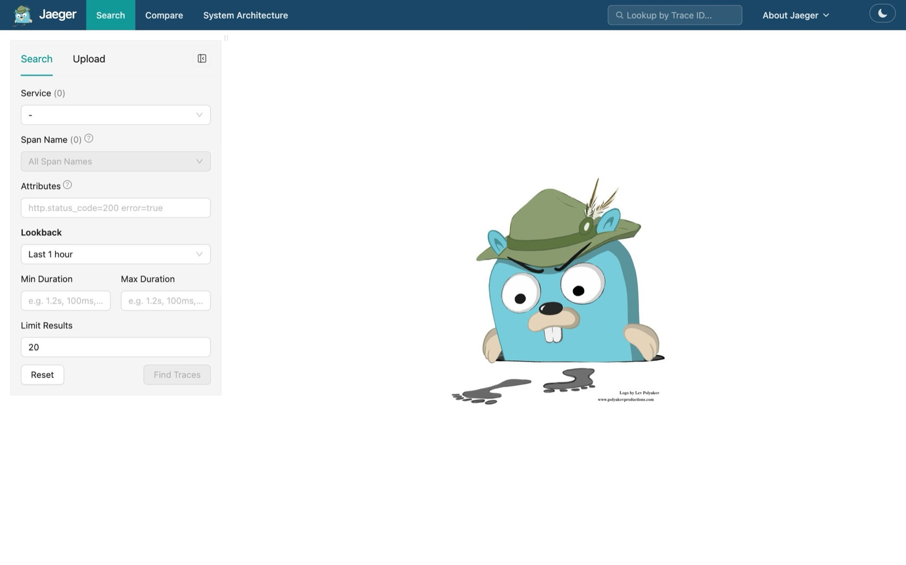
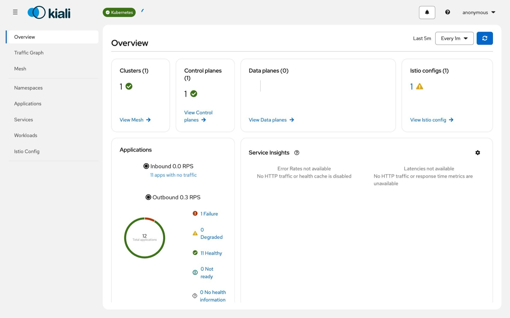

import { Aside } from '@astrojs/starlight/components';
import Terminal from '../../../components/Terminal.astro';

**Goal:** know every box in the `istio-system` namespace and which way the
telemetry flows, before you deploy anything that produces it.

```
                    namespace demo (step 2)                      namespace istio-system

  ┌──────────────────────────────┐   spans, OTLP gRPC :4317   ┌────────────────┐  OTLP   ┌────────┐
  │ pod                          │ ─────────────────────────► │ otel-collector │ ──────► │ jaeger │
  │  ┌─────────┐   ┌───────────┐ │                            └────────────────┘         └────────┘
  │  │   app   │◄─►│   Envoy   │ │   metrics, scraped :15020  ┌────────────────┐           ▲    ▲
  │  └─────────┘   └───────────┘ │ ◄───────────────────────── │   prometheus   │           │    │
  └──────────────────────────────┘                            └────────────────┘           │    │
                                                                 ▲           ▲             │    │
                                                              ┌──┴────┐   ┌──┴─────┐       │    │
                                                              │ kiali │   │grafana │       │    │
                                                              └──┬────┘   └────────┘       │    │
                                                                 └─────── traces ──────────┘   you
```

`make prepare` ran three groups of targets. This page goes through the
last two; you do not need to run them again.

```bash
make start-cluster    # kind
make dependencies     # cert-manager, OpenTelemetry operator, Kiali operator
make infra            # Istio, Prometheus, Grafana, Collector, Jaeger, Kiali
```

<Terminal src="status" title="make status" />

## The operators

Three things in the cluster only exist to manage other things.

- **[cert-manager](https://cert-manager.io/)** issues the TLS certificate
  of the OpenTelemetry operator's admission webhooks.
- **[OpenTelemetry operator](https://opentelemetry.io/docs/platforms/kubernetes/operator/)**
  adds two resource kinds you use in this tutorial: `OpenTelemetryCollector`
  (this page) and `Instrumentation` ([step 4](/kiali-tracing-tutorial/steps/04-auto-instrumentation/)).
- **[Kiali operator](https://kiali.io/docs/installation/installation-guide/install-with-helm/)**
  turns a `Kiali` resource into a running Kiali server. Installed with Helm.

```bash
kubectl get pods -n cert-manager
kubectl get pods -n opentelemetry-operator-system
kubectl get pods -n kiali-operator
```

## Istio

[Istio](https://istio.io/) is the service mesh. It injects an
[Envoy](https://www.envoyproxy.io/) proxy into every pod of the namespaces
you choose, and every request to or from the application goes through that
proxy. That one position gives Istio three things:

- **Traffic management.** Routing by weight, header or path, retries,
  timeouts, circuit breakers. Step 2 uses it to split traffic between two
  versions of one service.
- **Security.** Mutual TLS between workloads and authorization policies,
  without certificates in your code.
- **Observability.** The proxy reports metrics and trace spans for every
  request it sees. That is the part this tutorial is about.

`make istio` downloads `istioctl` and installs Istio from
[infra/istio.yaml](https://github.com/iblancasa/kiali-tracing-tutorial/blob/main/infra/istio.yaml).
The part that matters for tracing:

```yaml title="infra/istio.yaml (abridged)"
spec:
  profile: default
  meshConfig:
    enableTracing: true
    extensionProviders:
      - name: otel                    # a tracing backend the mesh knows about
        opentelemetry:
          service: otel-collector.istio-system.svc.cluster.local
          port: 4317                  # OTLP over gRPC
```

Declaring a provider does not turn it on. A
[`Telemetry`](https://istio.io/latest/docs/reference/config/telemetry/)
resource in the root namespace does, for the whole mesh:

```yaml title="infra/telemetry.yaml"
apiVersion: telemetry.istio.io/v1
kind: Telemetry
metadata:
  name: mesh-default
  namespace: istio-system
spec:
  tracing:
    - providers:
        - name: otel
      randomSamplingPercentage: 100   # every request. Fine on a laptop.
```

<Aside type="note" title="OTLP, not Zipkin">
Older Istio tutorials, the first version of this one included, point the
proxies at a Zipkin endpoint with `meshConfig.defaultConfig.tracing.zipkin`.
That still works. The OpenTelemetry provider is the current way: the
proxies speak OTLP, and they propagate context with the W3C `traceparent`
header instead of the `x-b3-*` headers. You meet `traceparent` again in
[step 3](/kiali-tracing-tutorial/steps/03-tracing-is-broken/).
</Aside>

The same file makes the ingress gateway a `NodePort` service on 30080,
which kind maps to [localhost:8080](http://localhost:8080). A cloud cluster
would use a `LoadBalancer` there.

## Prometheus

[Prometheus](https://prometheus.io/) stores metrics. `make prometheus`
applies the [Istio addon](https://istio.io/latest/docs/ops/integrations/prometheus/),
a single-pod Prometheus already configured to scrape every Envoy proxy and
the Istio control plane.

Everything Kiali draws comes from here: the edges of the graph, the request
rates, the error percentages and the response times are PromQL queries over
the `istio_requests_total` and `istio_request_duration_milliseconds`
series. Open [localhost:9090](http://localhost:9090). There is nothing
interesting yet, because nothing is in the mesh.

## Grafana

[Grafana](https://grafana.com/oss/grafana/) draws dashboards. `make grafana`
applies the [Istio addon](https://istio.io/latest/docs/ops/integrations/grafana/),
which comes with the Prometheus datasource and the Istio dashboards
provisioned: mesh, service, workload, control plane. Open
[localhost:3000](http://localhost:3000), **Dashboards**, folder **istio**.
Kiali links to these dashboards from its metrics tabs.

## OpenTelemetry Collector

The proxies do not send spans to Jaeger. They send them to the
[OpenTelemetry Collector](https://opentelemetry.io/docs/collector/), and
the Collector decides where they go. `make otelcol` creates an
`OpenTelemetryCollector` resource and the operator turns it into a
Deployment and a Service called `otel-collector`:

```yaml title="infra/otelcol.yaml (abridged)"
apiVersion: opentelemetry.io/v1beta1
kind: OpenTelemetryCollector
metadata:
  name: otel
  namespace: istio-system
spec:
  config:
    receivers:
      otlp:                    # 4317 gRPC: the Envoy proxies. 4318 HTTP: the applications, in step 4
    processors:
      batch: {}                # group spans before sending
    exporters:
      otlp_grpc/jaeger:
        endpoint: jaeger.istio-system.svc.cluster.local:4317
    service:
      pipelines:
        traces:
          receivers: [otlp]
          processors: [batch]
          exporters: [otlp_grpc/jaeger]
```

Why a hop in the middle?

- The mesh and the applications know one address. Change the backend, add
  a second one, add sampling: nothing in the mesh restarts.
- The Collector batches, retries, adds Kubernetes metadata, drops what you
  do not want and converts between protocols.
- In step 4 a second source of spans appears, the applications. They use
  the same Collector and nothing here changes.

```bash
kubectl get opentelemetrycollector -n istio-system
```

## Jaeger

[Jaeger](https://www.jaegertracing.io/) stores and shows traces. Version 2
is built on the OpenTelemetry Collector framework, so its configuration has
the same shape as the one above: an `otlp` receiver, a pipeline and two
Jaeger extensions for storage and for the query service. `make jaeger`
applies
[infra/jaeger.yaml](https://github.com/iblancasa/kiali-tracing-tutorial/blob/main/infra/jaeger.yaml):
one pod, traces in memory, gone on restart. Good for a tutorial and nothing
else.

Open [localhost:16686](http://localhost:16686). The **Service** dropdown is
empty.



<Aside type="note" title="No Jaeger operator">
The first version of this tutorial installed Jaeger with the Jaeger
operator. That operator only manages Jaeger v1, which is no longer
maintained. Jaeger v2 is one binary and one config file, and a plain
Deployment is enough.
</Aside>

## Kiali

[Kiali](https://kiali.io/) is the console of the mesh. It reads the Istio
configuration from the Kubernetes API, the metrics from Prometheus and the
traces from Jaeger, and shows them as one thing: topology, health,
configuration validation, metrics and traces per application.

`make kiali` creates a `Kiali` resource and the operator does the rest:

```yaml title="infra/kiali.yaml (abridged)"
apiVersion: kiali.io/v1alpha1
kind: Kiali
metadata:
  name: kiali
  namespace: istio-system
spec:
  auth:
    strategy: anonymous            # a laptop
  external_services:
    prometheus:
      url: http://prometheus.istio-system.svc.cluster.local:9090
    grafana:
      enabled: true
      internal_url: http://grafana.istio-system.svc.cluster.local:3000
      external_url: http://localhost:3000
    tracing:
      enabled: true
      provider: jaeger
      use_grpc: true
      internal_url: http://jaeger.istio-system.svc.cluster.local:16685
      external_url: http://localhost:16686
```

`internal_url` is what the Kiali pod uses to query. `external_url` is what
your browser gets when Kiali shows a link to Grafana or to the Jaeger UI.

<Aside type="caution" title="Not the Kiali addon">
Istio ships a Kiali addon next to the Prometheus and Grafana ones. This
tutorial does not use it, because the addon comes without the tracing
integration configured.
</Aside>

Open [localhost:20001](http://localhost:20001). Kiali shows one cluster,
the control plane and no applications.



## Is anything arriving?

Not yet. No pod has a sidecar, so nobody reports metrics or spans. Next:
put an application in the mesh.
