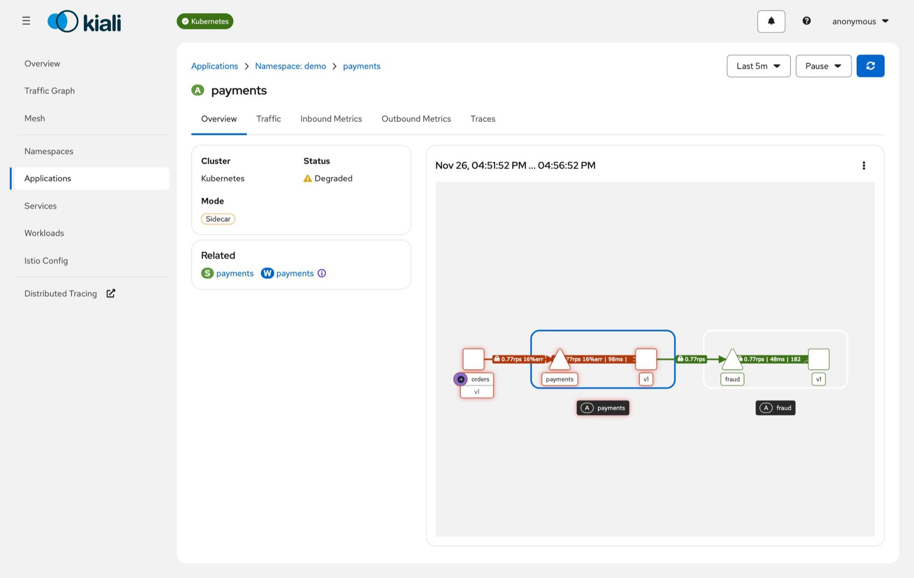
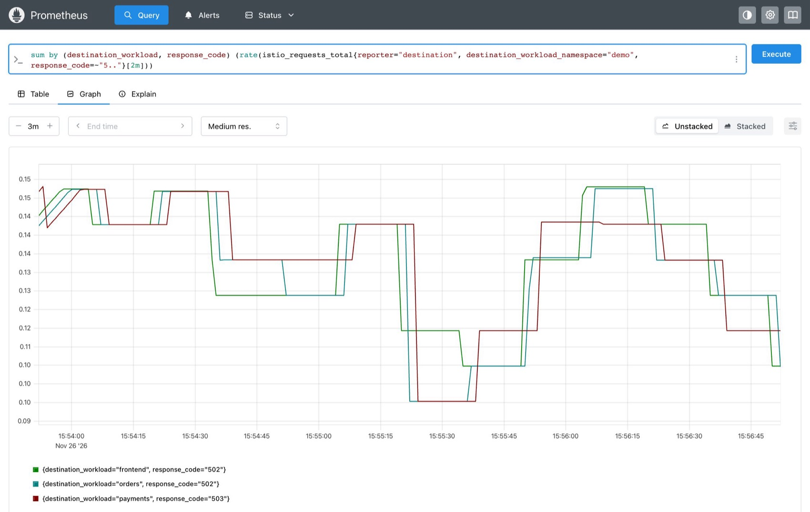
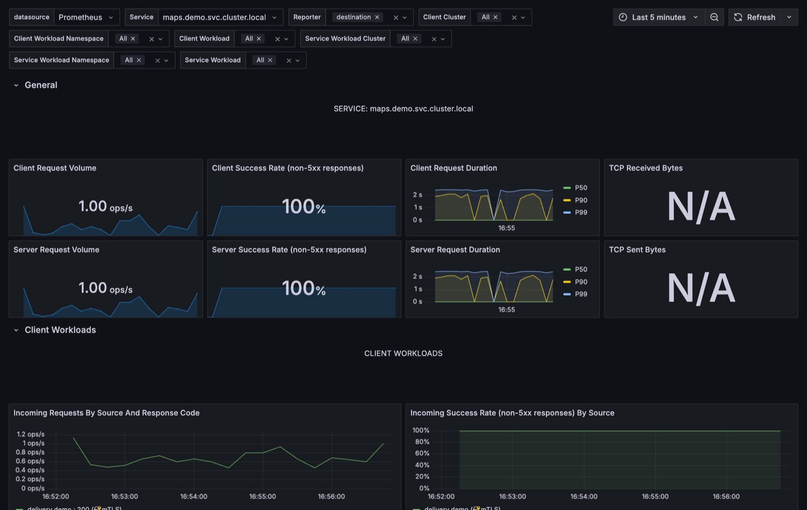

import { Aside, Steps } from '@astrojs/starlight/components';
import Terminal from '../../../components/Terminal.astro';

**Goal:** put an application in the mesh and see how much Kiali, Grafana
and Prometheus know about it when the application itself reports nothing.

## Mesh Pizza

The demo is a pizza shop made of small Python services. One image, one
module per service, all in
[apps/services/](https://github.com/iblancasa/kiali-tracing-tutorial/tree/main/apps/services).

```
loadgen -> ingress gateway -> frontend -+-> menu -+-> pricing -> promotions
                                        |         '-> reviews (v1 80%, v2 20%) -> ratings (v2 only)
                                        |
                                        '-> orders -+-> inventory -> redis (TCP)
                                                    +-> payments -> fraud
                                                    +-> kitchen -> inventory
                                                    +-> delivery -> maps
                                                    '-> notifications
```

| Service | What it does |
|---------|--------------|
| `frontend` | The page and the public API. The only service reachable from outside. |
| `menu` | The list of pizzas. Asks `pricing` and `reviews`. |
| `pricing`, `promotions` | List prices, minus today's discounts. |
| `reviews` v1 and v2 | What people say. v2 also asks `ratings` for stars. |
| `orders` | Takes an order through `inventory`, `payments`, `kitchen`, `delivery` and `notifications`. |
| `inventory`, `redis` | Stock counters, kept in Redis. |
| `payments`, `fraud` | Charges the card after a fraud check. |
| `kitchen` | Makes a ticket for the cooks, asks `inventory` for the recipe. |
| `delivery`, `maps` | Books a rider, needs a route for the ETA. |
| `notifications` | Tells the customer. |
| `loadgen` | Background customers, three requests per second. Lives outside the mesh. |

Two of these services have a problem. You find out which in a few minutes.

## Deploy it

```bash
make deploy-apps
```

That is `kubectl apply -f apps/manifest.yaml` and a wait for the rollout.

<Terminal src="deploy" title="make deploy-apps" maxHeight="22rem" />

The manifest starts with the namespace, and one label on it is all Istio
needs:

```yaml title="apps/manifest.yaml"
apiVersion: v1
kind: Namespace
metadata:
  name: demo
  labels:
    istio-injection: enabled
```

Every pod shows `2/2`. The second container is the Envoy proxy. Nothing in
the Deployments asked for it:

<Terminal src="sidecar" title="Containers of the orders pod" />

`istio-init` sets up the traffic redirection and `istio-proxy` is Envoy,
running as a sidecar next to `orders`.

## Let traffic in

Requests from outside enter through the Istio ingress gateway. Two
resources in the manifest tell it what to do.

A [`Gateway`](https://istio.io/latest/docs/reference/config/networking/gateway/)
opens a port on the ingress gateway pods:

```yaml title="apps/manifest.yaml"
apiVersion: networking.istio.io/v1
kind: Gateway
metadata:
  name: demo-gateway
  namespace: demo
spec:
  selector:
    istio: ingressgateway
  servers:
  - port:
      number: 80
      name: http
      protocol: HTTP
    hosts:
    - "*"
```

A [`VirtualService`](https://istio.io/latest/docs/reference/config/networking/virtual-service/)
bound to that gateway sends everything to `frontend`:

```yaml title="apps/manifest.yaml"
apiVersion: networking.istio.io/v1
kind: VirtualService
metadata:
  name: frontend
  namespace: demo
spec:
  hosts:
  - "*"
  gateways:
  - demo-gateway
  http:
  - route:
    - destination:
        host: frontend
        port:
          number: 8080
```

The same two kinds of object, plus a
[`DestinationRule`](https://istio.io/latest/docs/reference/config/networking/destination-rule/)
that names the versions, split the traffic of `reviews`: 80% to v1, 20% to
v2. Look for `name: reviews` in the manifest.

Open [localhost:8080](http://localhost:8080) and order a pizza or two. Or
stay in the terminal:

```bash
make order
make traffic-logs
```

<Terminal src="traffic" title="The load generator, and one order by hand" />

Most orders take about 150 ms. Some take more than a second and a half.
Some fail with a 502. Nobody told you which service is responsible.

## Read the topology in Kiali

Open [localhost:20001](http://localhost:20001), **Traffic Graph**, select
the namespace **demo**. In **Display**, turn off **Service Nodes** to get
the same picture as here.


Nobody drew this. Kiali builds it from the `istio_requests_total` series
that every proxy reports, so it is the system as it behaves now, not as
somebody documented it. Things to notice:

- **Colour is health.** Green edges answer 2xx. The red path goes from
  `frontend` to `orders` to `payments` and stops there: the edge from
  `payments` to `fraud` is green.
- **`reviews` is one box with two versions.** Kiali groups workloads by
  the `app` and `version` labels. Only v2 has an edge to `ratings`.
- **The edge to `redis` is blue.** Blue is TCP. The mesh sees bytes there,
  not requests, so no status codes and no response times.
- **The traffic starts at `istio-ingressgateway`.** The load generator is
  outside the mesh, has no proxy and reports nothing.

Click an edge or a node and the side panel shows its request rate, error
percentage and response time. In **Display** you can put the same numbers
on the edges: **Response Time**, **Traffic Rate**, **Traffic Distribution**.
Turn on **Traffic Animation** if you want to impress somebody.

## Find the failing service

<Steps>

1. Click the `payments` node, then its name in the side panel. Or go to
   **Applications**, `payments`.

   

   Around 15% of the requests that `orders` sends to `payments` fail. The
   calls from `payments` to `fraud` do not. So the errors are produced
   inside `payments`, and `orders` and `frontend` only pass them on.

2. The lock on each edge means mutual TLS. The services speak plain HTTP;
   the proxies encrypt and authenticate every hop.

3. Open the **Inbound Metrics** tab. Request volume, duration and sizes of
   everything `payments` receives, split by response code if you choose so
   in **Metrics Settings**. Every tab has a **View in Grafana** link.

</Steps>

The same question in PromQL, because Kiali is only asking Prometheus.
[localhost:9090](http://localhost:9090):

```text title="PromQL"
sum by (destination_workload, response_code) (
  rate(istio_requests_total{reporter="destination", destination_workload_namespace="demo", response_code=~"5.."}[2m])
) > 0
```



<Terminal src="promql" title="The same query through the Prometheus API" />

Three workloads return 5xx at the same rate. `payments` answers 503, and
the two services above it turn that into a 502. One root cause, three
alerts. The graph in Kiali told you the direction; the numbers alone would
not.

The reason is in the code
([apps/services/payments.py](https://github.com/iblancasa/kiali-tracing-tutorial/blob/main/apps/services/payments.py)):
a simulated bank that fails 15% of the charges.

## Find the slow service

Orders that take 1.5 seconds are not errors, so nothing is red. In the
graph, **Display**, **Response Time**, **95th Percentile**: the edges
`frontend` to `orders`, `orders` to `delivery` and `delivery` to `maps`
show more than a second, everything else a few milliseconds.

Grafana has the detail. [localhost:3000](http://localhost:3000),
**Dashboards**, **istio**, **Istio Service Dashboard**, service
`maps.demo.svc.cluster.local`:



Success rate 100%. Median near zero. The 90th percentile around two
seconds. `maps` answers fast most of the time and very slowly about one
time in five, and every service above it inherits the delay. In the code
([apps/services/maps.py](https://github.com/iblancasa/kiali-tracing-tutorial/blob/main/apps/services/maps.py))
it is a geocoder cache that misses 20% of the time.

## What the mesh gave you for free

| You wanted to know | Where | Who had to instrument it |
|---|---|---|
| Who calls whom | Kiali graph | nobody |
| Which service fails, and how often | Kiali health, Prometheus | nobody |
| Which service is slow, at which percentile | Kiali response time, Grafana | nobody |
| Whether the traffic is encrypted | Kiali, the lock on the edges | nobody |

All of it comes from metrics the proxies report. Metrics are counters per
pair of workloads. They cannot tell you what happened to *one* order: which
of the five calls of `orders` was the slow one this time, or which request
of `frontend` ended in that 503. That is what traces are for. Open
[Jaeger](http://localhost:16686), pick the service
`istio-ingressgateway.istio-system` and press **Find Traces**.

<Aside type="caution" title="Something is off">
Every trace has exactly three spans. An order goes through ten
workloads. Next step.
</Aside>
