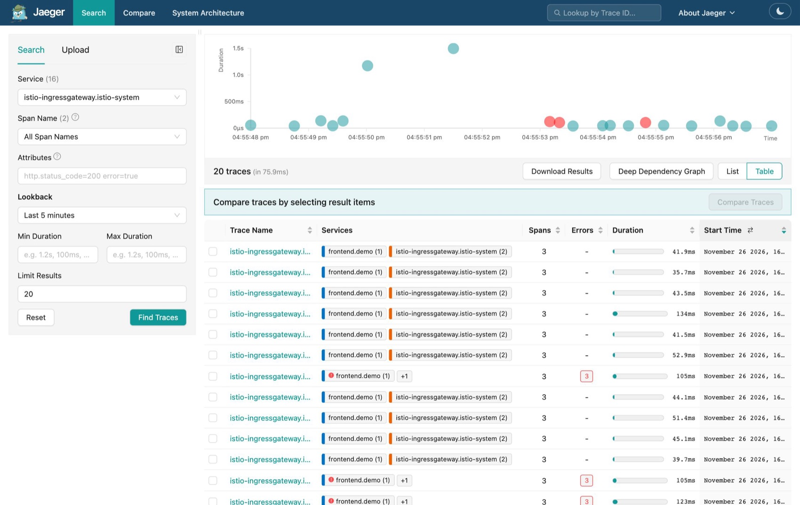
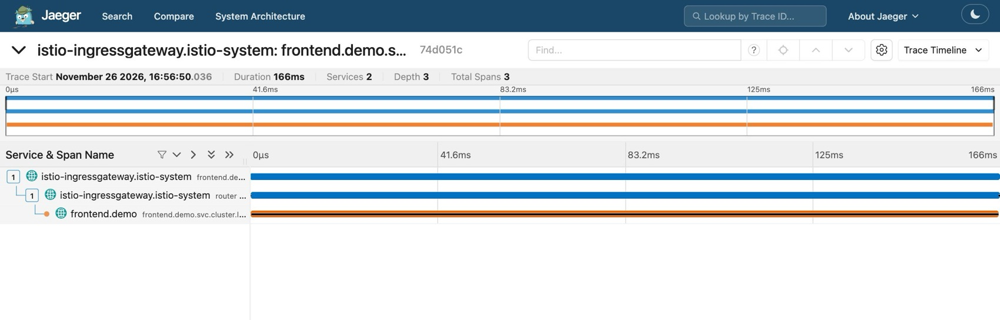
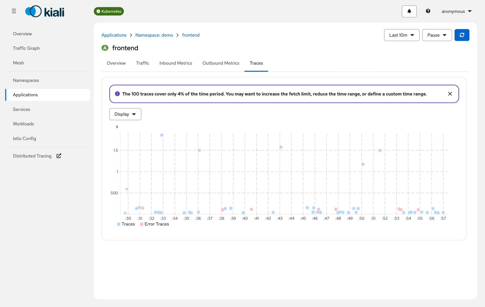
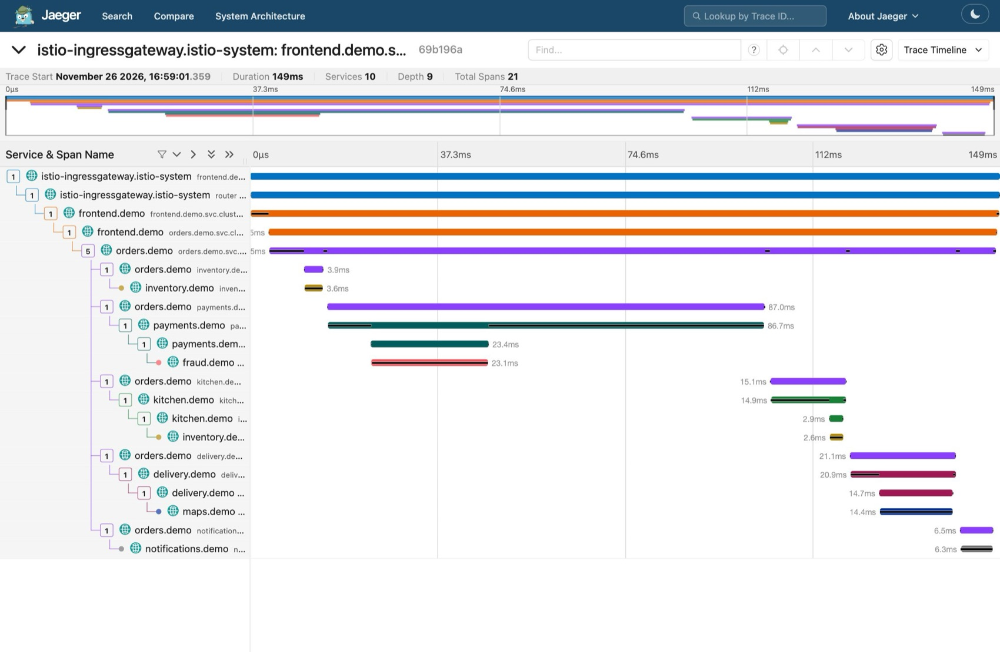
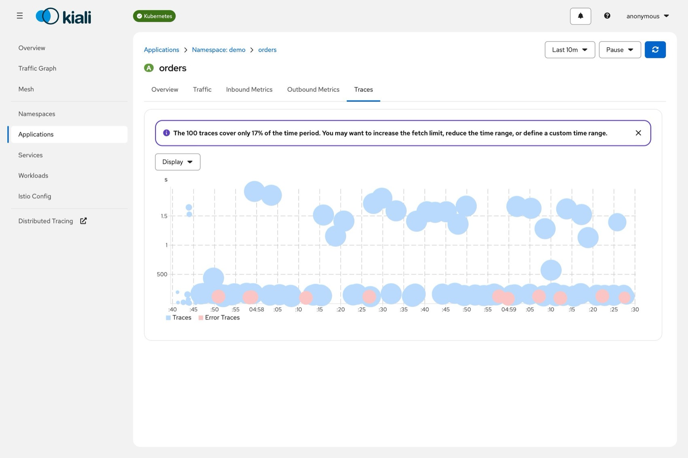
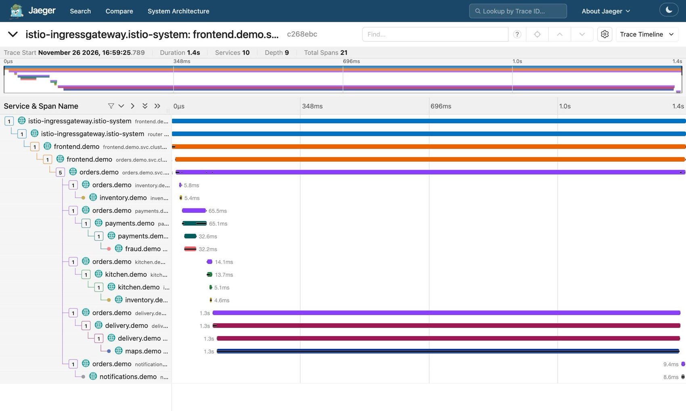
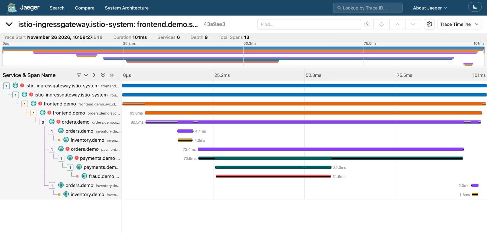

import { Aside, Steps } from '@astrojs/starlight/components';
import Terminal from '../../../components/Terminal.astro';

**Goal:** understand why the mesh produces spans but not traces, and fix
it the way people did before auto-instrumentation: in the code.

## The symptom

[Jaeger](http://localhost:16686), service
`istio-ingressgateway.istio-system`, **Find Traces**:



Every trace has three spans and two services. Open one:



The ingress gateway received the request and sent it to `frontend`. The
proxy of `frontend` received it. The trace ends there, although you know
from Kiali that `frontend` then called `orders`, which called five more
services.

The other spans exist. They are in other traces.
[scripts/traces.py](https://github.com/iblancasa/kiali-tracing-tutorial/blob/main/scripts/traces.py)
asks the Jaeger API for the latest traces of one service and prints one
line per trace:

```bash
scripts/traces.py
scripts/traces.py orders.demo --show 1
```

<Terminal src="broken" title="scripts/traces.py" />

Hundreds of traces, two or three spans each. One trace for
`orders -> kitchen`, another for `orders -> payments`, another for
`orders -> inventory`. Nothing says they were the same pizza.

Kiali has the same data, so it has the same problem.
**Applications**, `frontend`, **Traces**: many small dots, none with more
than three spans.



## Context propagation

A trace is a tree of spans that share one **trace id**. A span joins a
trace when it knows two things: the trace id, and the id of the span that
caused it, its parent. Both travel with the request, in headers. This is
*context propagation*.

With the OpenTelemetry provider, Istio uses the
[W3C Trace Context](https://www.w3.org/TR/trace-context/) format, a single
header:

```
traceparent: 00-4bf92f3577b34da6a3ce929d0e0e4736-00f067aa0ba902b7-01
             │  │                                │                │
             │  trace id                         parent span id   sampled
             version
```

Every Envoy proxy does the same thing with every request it handles:

<Steps>

1. If the request has a `traceparent`, use its trace id and take its span
   id as the parent. If it has none, start a new trace.
2. Create a span.
3. Send the request on with a `traceparent` that names this new span.

</Steps>

## Did the mesh not do this for me?

It did everything it can. Follow one order:

<Steps>

1. The ingress gateway receives `POST /api/orders` with no `traceparent`.
   It starts trace **A** and forwards the request with `traceparent: A`.

2. The proxy of `frontend` sees trace **A**, creates its span, and hands
   the request to the `frontend` container with `traceparent: A`.

3. The `frontend` code handles the request. To do so it sends a **new**
   HTTP request to `orders`. It is a different request, built by the
   application, and the application does not copy the header into it.

4. The proxy of `frontend` sees an outgoing request with no `traceparent`.
   For Envoy this is a request like any other: it cannot know which
   incoming request caused it. It starts trace **B**.

5. The same happens at `orders`, five times, and at every service below.

</Steps>

```
 trace A                              trace B                       trace C ...
 ┌─────────┐  ┌────────────────┐      ┌────────────────┐  ┌──────────────┐
 │ ingress │─►│ frontend proxy │─► ✂  │ frontend proxy │─►│ orders proxy │─► ✂
 └─────────┘  └────────────────┘      └────────────────┘  └──────────────┘
                     │   frontend code   ▲
                     └──►  receives A,  ─┘
                           sends nothing
```

The proxy sees requests going in and requests coming out. The link between
the two exists only inside the application, so only the application can
carry the context across.

<Aside type="note" title="The metrics were fine. Why?">
A metric counts requests between two workloads. It needs to know who is
calling whom, and the proxies know that from the connection. It never needs
to relate one request to another. A trace is exactly that relation.
</Aside>

## The fix, by hand

Every service of the shop makes its calls through one function, and that
function already knows how to forward the headers. It is turned off
([apps/services/common.py](https://github.com/iblancasa/kiali-tracing-tutorial/blob/main/apps/services/common.py)):

```python title="apps/services/common.py"
PROPAGATE_TRACE_HEADERS = os.environ.get('PROPAGATE_TRACE_HEADERS', 'false').lower() == 'true'

TRACE_HEADERS = [
    # W3C Trace Context: what Istio uses with the OpenTelemetry provider
    'traceparent',
    'tracestate',
    # B3 multi: what Istio uses with the Zipkin provider
    'x-b3-traceid',
    'x-b3-spanid',
    'x-b3-parentspanid',
    'x-b3-sampled',
    'x-b3-flags',
    # Envoy request id
    'x-request-id',
]


def trace_headers():
    """The trace context of the request being handled, ready to be sent on."""
    if not PROPAGATE_TRACE_HEADERS:
        return {}
    incoming = flask.request.headers  # case-insensitive
    return {name: incoming[name] for name in TRACE_HEADERS if name in incoming}


def call(method, service, path, **kwargs):
    """Call another service of the shop, for example call('GET', 'pricing', '/prices')."""
    url = f'http://{service}:8080{path}'
    return requests.request(method, url, headers=trace_headers(), timeout=10, **kwargs)
```

That is the whole technique: read a few headers from the request you are
handling, put them on every request you make because of it. The list has
both formats so the code works whichever provider the mesh uses.
`x-request-id` is Envoy's own
[request id](https://www.envoyproxy.io/docs/envoy/latest/intro/arch_overview/observability/tracing),
useful to join access logs.

Turn it on:

```bash
make propagate
```

That is one `kubectl` command, which restarts the pods with the new
variable:

```bash
kubectl -n demo set env deployment -l 'app!=redis' PROPAGATE_TRACE_HEADERS=true
```

<Terminal src="propagate" title="make propagate" maxHeight="16rem" />

## Complete traces

Give it a minute, then:

```bash
scripts/traces.py --minutes 1 --show 1
```

<Terminal src="propagated" title="scripts/traces.py --minutes 1 --show 1" />

Same proxies, same Collector, same Jaeger. The only change is that the
applications pass a header along, and the two-span traces became one trace
per customer request, with the whole tree in it.

In [Jaeger](http://localhost:16686), search again with **Lookback** set to
the last 5 minutes and open an order:



Each hop is two spans: the proxy of the caller (client side) and the proxy
of the callee (server side). The gap between them is the network.

In Kiali, **Applications**, `orders`, **Traces**. The size of a dot is the
number of spans of the trace. You can see the minute you ran
`make propagate`:



Click a dot and Kiali shows the spans of that trace under the chart, with
a link to open it in Jaeger.

## Now ask the traces

In step 2 the metrics said that `maps` is slow at the 90th percentile and
that `payments` fails 15% of the time. A trace says what that did to one
order.

**A slow order.** In Jaeger, **Min Duration** `1s`:



The order took 1.4 s. `inventory`, `payments`, `kitchen` and
`notifications` took 100 ms together. The other 1.3 s are the call from
`delivery` to `maps`. No dashboard, no percentile, no guess: this order,
this call.

**A failed order.** In Jaeger, **Attributes** `error=true`:



The error marks go down from the ingress gateway to `payments` and stop:
`fraud` answered fine, so the failure is in `payments`. And there is a
detail no metric showed: after the failed charge, `orders` calls
`inventory` a second time. That is the code giving the ingredients back.
The kitchen, the rider and the notification never happen.

## It works. Is it a good idea?

For this shop it took one function, because every service is Python, uses
the same HTTP library and was written by the same person. Now imagine:

- 100 services in five languages, with different HTTP clients, gRPC and a
  message queue.
- A team that forgets one call. The trace breaks there, silently, and you
  find out during an incident.
- A change of format, from B3 to W3C, in every repository.
- Spans for things that are not HTTP. The call from `inventory` to Redis
  is still not in the trace. The mesh sees it as TCP bytes.

The next step gets the same result without this code, and more.
