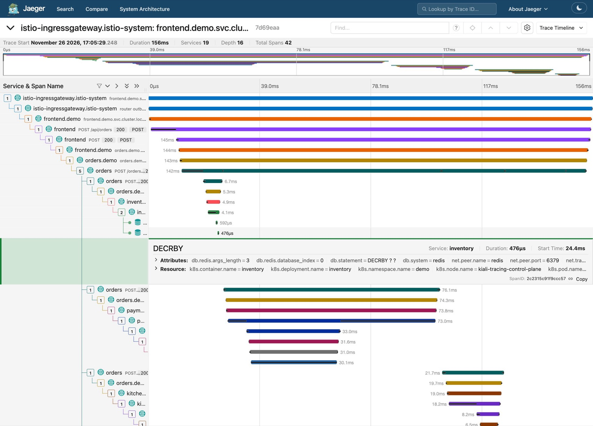

import { Aside, Steps } from '@astrojs/starlight/components';
import Terminal from '../../../components/Terminal.astro';

**Goal:** the complete traces of step 3, without a line of propagation
code in the applications.

## Pretend nobody wrote that function

Turn the header forwarding off again. This is the state of most real
codebases:

```bash
make unpropagate
```

<Terminal src="unpropagate" title="make unpropagate" />

After a minute the traces are in pieces again:

<Terminal src="rebroken" title="scripts/traces.py --minutes 1 --lines 3" />

## The Instrumentation resource

The OpenTelemetry project ships
[zero-code instrumentation](https://opentelemetry.io/docs/concepts/instrumentation/zero-code/)
for several languages: an agent that loads next to your application and
patches the libraries it uses. For Python that means Flask, `requests`,
Redis clients, database drivers and many more.

The OpenTelemetry operator automates the delivery. You describe the
settings once in an
[`Instrumentation`](https://opentelemetry.io/docs/platforms/kubernetes/operator/automatic/)
resource, annotate the pods that should get it and the operator injects
everything when the pod is created.

```yaml title="infra/instrumentation.yaml"
apiVersion: opentelemetry.io/v1alpha1
kind: Instrumentation
metadata:
  name: python
  namespace: demo
spec:
  exporter:
    # Python auto-instrumentation speaks OTLP over HTTP (http/protobuf),
    # so the endpoint is the Collector's 4318 port, not 4317.
    endpoint: http://otel-collector.istio-system.svc.cluster.local:4318
  propagators:
    - tracecontext
    - baggage
  sampler:
    type: parentbased_traceidratio
    argument: "1"
  python:
    env:
      - name: OTEL_METRICS_EXPORTER
        value: none
      - name: OTEL_LOGS_EXPORTER
        value: none
      - name: OTEL_PYTHON_EXCLUDED_URLS
        value: healthz
```

Four parts:

- **`exporter`**: where the spans go. The same Collector the proxies use,
  on its HTTP port.
- **`propagators`**: which headers the SDK reads and writes.
  [`tracecontext`](https://opentelemetry.io/docs/concepts/context-propagation/)
  is `traceparent`, the format the proxies use. `baggage` carries your own
  key-value pairs along the request.
- **`sampler`**: `parentbased` means "do what the caller decided". The
  ingress gateway takes the decision, everything else follows.
- **`python.env`**: extra settings for the Python SDK. The Collector of
  this tutorial only has a traces pipeline, so metrics and logs export is
  off. And the kubelet's health checks get no traces.

<Aside type="caution" title="The propagators must match the mesh">
The first version of this tutorial listed `b3multi` here, because Istio
was configured with the Zipkin provider and spoke B3. With the
OpenTelemetry provider the proxies only update `traceparent`. If the
applications also send B3 headers, those pass through the proxies
untouched and the receiving application trusts them: its spans end up as
siblings of the proxy spans instead of children. One format, the same on
both sides.
</Aside>

## Inject it

```bash
make instrument
```

Two commands. Create the resource, then add two annotations to the pod
template of every deployment of the shop, Redis excluded:

```bash
kubectl apply -f infra/instrumentation.yaml
kubectl -n demo patch deployment/orders --type merge -p '{"spec":{"template":{"metadata":{"annotations":{
  "instrumentation.opentelemetry.io/inject-python":"true",
  "traffic.sidecar.istio.io/excludeOutboundPorts":"4318"}}}}}'
```

<Terminal src="instrument" title="make instrument" maxHeight="20rem" />

The first annotation is the request to the OpenTelemetry operator. The
second one is for Istio: the SDK sends its spans to the Collector with
HTTP requests, the sidecar would trace those requests too, and you would
get a trace about every export of traces. Port 4318 skips the proxy.

Changing the pod template starts a rollout, so there is nothing to
restart. Look at a new pod:

<Terminal src="injected" title="What the operator added to the orders pod" />

- An init container, `opentelemetry-auto-instrumentation-python`, copies
  the instrumentation libraries into a volume shared with the application.
- `PYTHONPATH` points at that volume, so Python loads the instrumentation
  before the application code.
- The `OTEL_*` variables are the `Instrumentation` resource, translated.
  `OTEL_SERVICE_NAME` comes from the name of the Deployment.

The image did not change. The code did not change.
`PROPAGATE_TRACE_HEADERS` is not set.

## More than what you had

```bash
scripts/traces.py --minutes 1 --show 1
```

<Terminal src="instrumented" title="scripts/traces.py --minutes 1 --show 1" maxHeight="34rem" />

The traces are complete again, and about twice as long. Where step 3 had
two spans per hop, there are now four:

```
frontend            POST                               the requests library, sending       (application)
  frontend.demo     orders.demo.svc.cluster.local      Envoy of frontend, client side      (mesh)
    orders.demo     orders.demo.svc.cluster.local      Envoy of orders, server side        (mesh)
      orders        POST /orders                       Flask, handling                     (application)
```

Two kinds of service name are in the tree. `orders.demo` is the proxy:
Istio names it `<app>.<namespace>`. `orders` is the application, named by
the operator. They are nested correctly because both sides speak
`traceparent`: the SDK injects it, the proxy reads it and replaces it with
its own span, the next proxy does the same, the next SDK extracts it.

In [Jaeger](http://localhost:16686), open an order and click one of the
two short spans under `inventory`:



What the application spans add:

- **Real operation names.** `POST /orders` and `GET /ingredients/<pizza>`,
  the Flask route, instead of `orders.demo.svc.cluster.local:8080/*`.
- **Redis.** `SETNX` and `DECRBY` with `db.system=redis`. In step 2 the
  mesh saw that call as TCP bytes on a blue edge. It is in the trace now,
  with its duration.
- **Time inside the application.** The difference between the Flask span
  and the proxy span around it is the time the request spent between the
  proxy and your code.
- **Kubernetes metadata.** Every application span carries
  `k8s.pod.name`, `k8s.deployment.name` and `k8s.namespace.name`.

Kiali reads the same traces. **Applications**, `orders`, **Traces**: the
dots are bigger again, and the span list of a trace now mixes proxy spans
and application spans.

## What you did, and did not do

| | Step 3: by hand | Step 4: auto-instrumentation |
|---|---|---|
| Code changes | one function, called on every outgoing request | none |
| New language or HTTP client | write it again | another annotation (`inject-java`, `inject-nodejs`, `inject-dotnet`) |
| Spans per hop | 2, from the proxies | 4, proxies and application |
| Non-HTTP calls (Redis, SQL, queues) | invisible | traced |
| Change of propagation format | every repository | one line in the `Instrumentation` |
| Cost | discipline | an init container, some CPU and memory per pod |

The mesh and the SDK do not compete. The proxies see the network: retries,
TLS, connection errors, requests that never reached your code. The SDK
sees the inside of the application. With the context propagated, both end
up in one trace.

<Aside type="tip" title="Undo">
`make uninstrument` removes the annotations and the `Instrumentation`.
`make reset` goes back to the start of step 2 and empties Jaeger.
</Aside>
